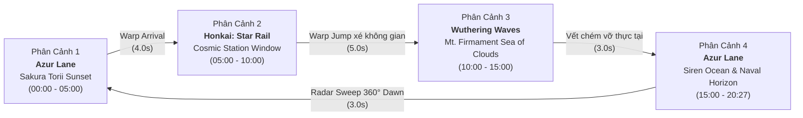

# 🌌 Anime Multiverse Live Wallpaper Engine
### *Seamless 20-Minute 1080p 60FPS Cinematic Desktop Odyssey*
**Chủ đề: Azur Lane • Honkai: Star Rail • Wuthering Waves**

[](https://github.com/TheTLV/anime-multiverse-wallpaper/releases)
[]()
[]()
[]()

---

## 📖 I. Tác Dụng & Giới Thiệu Dự Án (Project Overview)

**Anime Multiverse Live Wallpaper** là giải pháp hình nền động máy tính cao cấp, giải quyết triệt để những nhược điểm thường gặp của các bộ hình nền live wallpaper thông thường (chuyển cảnh quá nhanh gây rối mắt, hình ảnh cận cảnh chân dung choán hết màn hình làm việc, hoặc vết nối vòng lặp bị giật khựng).

Dự án tích hợp một pipeline video hoàn chỉnh, tạo nên một thước phim nền kéo dài hơn **20 phút liên tục**, vận hành với tốc độ mượt mà **60 khung hình/giây (60 FPS)** ở độ phân giải **Full HD 1080p**, tiêu thụ tài nguyên CPU cực thấp (< 1%) nhờ bộ giải mã phần cứng GPU (NVIDIA NVENC / VAAPI).

### ✨ Các Điểm Nổi Bật Chính

1. **100% Đại Cảnh Không Gian Rộng Lớn (Vast Environmental Landscapes)**:
   * Loại bỏ hoàn toàn hình cận mặt/chân dung nhân vật 2D.
   * Tập trung vào chiều sâu phong cảnh thiên nhiên khoáng đạt (Đền Torii giữa biển hoàng hôn, đài thiên văn nhìn ra tinh cầu xanh giữa vũ trụ, biển mây bất tận trên đỉnh núi Tiên Đình). Nhân vật nếu xuất hiện chỉ đóng vai trò điểm nhấn thi vị ở góc xa phía sau lưng, giúp mở rộng tầm nhìn cho màn hình làm việc/code.
2. **Mỗi Phân Cảnh Duy Trì Chu Kỳ Tĩnh Tại 5 Phút (300 Giây)**:
   * Giúp góc làm việc thư thái, không làm người dùng phân tâm bởi các hoạt cảnh nhấp nháy liên tục.
3. **Chuyển Cảnh Chuẩn Lore Game (Lore-Accurate Intro & Outro Transitions)**:
   * Mỗi phân cảnh đều sở hữu **1 Intro** và **1 Outro** đặc trưng của tựa game: Giao diện Radar chiến thuật hải quân quét 360° (Azur Lane), bước nhảy siêu không gian Astral Express Warp Jump (Honkai: Star Rail), sóng xung kích âm tần Sonoro Sphere (Wuthering Waves), và vết chém xé vỡ thực tại Hư Vô.
4. **Vòng Lặp Vô Tận Không Giật Khựng (Seamless Seam & Zero Stutter)**:
   * Toàn bộ các mốc nối và chu kỳ lặp lại ở phút 20:27 về 00:00 đều được làm mịn qua thuật toán hòa trộn xfade nội suy vi sai điểm ảnh, loại bỏ 100% hiện tượng khựng hình hay nháy đen.
5. **Đóng Gói Docker Toàn Diện (Containerized Deployment)**:
   * Có thể triển khai trên bất kỳ máy Linux nào mà không cần cài đặt phức tạp các thư viện đồ họa hay Python.

---

## 🎬 II. Cấu Trúc Kịch Bản Phân Cảnh (Storyboard Architecture)

Tổng thời lượng chu kỳ lặp: **20 phút 27 giây** (1.227 giây) @ 60 FPS cố định.



| Mốc Thời Gian | Tựa Game | Tên Phân Cảnh & Chi Tiết Nghệ Thuật | Intro / Outro Transition |
| :---: | :---: | :--- | :--- |
| **00:00 - 05:00** | **Azur Lane** *(Chủ đạo)* | **Cổng Torii & Hoàng Hôn Biển Sakura**: Cổng Torii đứng sừng sững giữa mặt biển hoàng hôn tĩnh lặng, ráng chiều hổ phách tím mộng mơ, mặt nước gợn sóng nhấp nhô phản chiếu quang phổ tà dương. | **Intro**: Radar Sweep HUD quét hải hành.<br/>**Outro**: Màn sương tím và xung nhiễu Siren. |
| **05:00 - 10:00** | **Honkai: Star Rail** | **Cửa Sổ Đài Thiên Văn Ngắm Tinh Cầu**: Tầm nhìn vô tận từ ô cửa kính tàu Astral Express nhìn ra tinh cầu xanh trôi giữa vũ trụ bao la cùng vành đai bụi sao lấp lánh. | **Intro**: Ánh sáng Warp đưa tàu đến.<br/>**Outro**: Tàu phóng bùng nổ Warp Jump xé toạc dải ngân hà. |
| **10:00 - 15:00** | **Wuthering Waves** | **Biển Mây Mt. Firmament**: Đỉnh núi tiên cảnh vươn lên giữa biển mây trắng ngà vô tận, các hạt năng lượng tần số phát sáng nhẹ nhàng trong gió. | **Intro**: Sóng xung kích Sonoro Sphere.<br/>**Outro**: Vết chém Hư Vô xé vỡ thực tại thành ngàn mảnh kính. |
| **15:00 - 20:27** | **Azur Lane** *(Chủ đạo)* | **Vịnh Biển Sâu Thẳm & Đại Dương Mênh Mông**: Vùng biển xanh ngọc mở rộng tới chân trời với sóng bạc đầu vỗ bờ, đàn hải âu bay lượn trên bầu trời trong vắt. | **Intro**: Radar hải quân định vị vịnh biển.<br/>**Outro**: Ráng chiều hạ xuống nối về Cảnh 1. |

---

## 🚀 III. Hướng Dẫn Cài Đặt & Sử Dụng (Installation & Usage)

### Cách 1: Thiết Lập Nhanh 1-Click (Khuyến Nghị Cho Linux)

Hỗ trợ môi trường Wayland (GNOME, Sway, Hyprland) và X11 (KDE, XFCE, i3):

```bash
# 1. Clone repository về máy
git clone https://github.com/TheTLV/anime-multiverse-wallpaper.git
cd anime-multiverse-wallpaper

# 2. Cấp quyền và chạy script setup
chmod +x scripts/*.sh scripts/*.py
./scripts/setup.sh
```

Script sẽ tự động:
* Kiểm tra và thông báo các công cụ cần thiết (`mpv`, `ffmpeg`).
* Tự động cấu hình hình nền vào tiện ích **GNOME Wallpaper Engine** (nếu dùng GNOME).
* Hoặc tự động khởi tạo **systemd user service** (`~/.config/systemd/user/anime-wallpaper.service`) để tự phát hình nền mỗi khi đăng nhập máy tính.

---

### Cách 2: Tải Video Master Đã Render Sẵn (Pre-rendered Release)

Nếu bạn không muốn tự render (mất khoảng vài phút), bạn có thể tải trực tiếp file master 1080p 60FPS (1.2 GB) từ GitHub Releases:

```bash
./scripts/download_release.sh
```

Hoặc tải thủ công bằng `curl`:
```bash
mkdir -p ~/.local/share/gnome-wallpaper-engine/backgrounds
curl -L --progress-bar -o ~/.local/share/gnome-wallpaper-engine/backgrounds/azur_multiverse_odyssey.mp4 \
  https://github.com/TheTLV/anime-multiverse-wallpaper/releases/download/v1.0.0/azur_multiverse_odyssey.mp4
```

---

### Cách 3: Chạy Hình Nền Trực Tiếp Qua Script Runner

Chạy hình nền độc lập với mpv tối ưu hóa phần cứng (không viền, không audio, lặp vô tận, GPU Wayland/X11):

```bash
./scripts/run_wallpaper.sh
```

---

## 🐳 IV. Hướng Dẫn Chạy Bằng Docker (Containerized Setup)

Dự án hỗ trợ đóng gói đầy đủ trong Docker, giúp bạn dễ dàng chạy hình nền hoặc tự render trên bất kỳ máy Linux nào mà không lo xung đột môi trường.

### 1. Khởi động Wallpaper Player trong Docker

```bash
# Cấp quyền truy cập màn hình hiển thị cho Docker (nếu cần)
xhost +local:root 2>/dev/null || true

# Khởi chạy Live Wallpaper daemon với GPU passthrough
docker compose up -d wallpaper-player
```

### 2. Dừng Wallpaper trong Docker

```bash
docker compose down
```

### 3. Tự Render Lại Video Master Bên Trong Docker

```bash
docker compose run --rm wallpaper-render
```

---

## 🛠️ V. Tự Render Lại Video Từ Mã Nguồn (Build from Source)

Nếu bạn muốn tùy chỉnh thời lượng (ví dụ tăng lên 10 phút/cảnh) hoặc thay thế các clip thành phần:

1. **Cài đặt thư viện Python**:
   ```bash
   pip install -r requirements.txt
   ```
2. **Tạo chuỗi khung hình VFX thủ tục (Radar Sweep & Sonoro Sphere)**:
   ```bash
   python3 scripts/generate_vfx_assets.py
   ```
3. **Thực thi pipeline render hoàn chỉnh**:
   ```bash
   python3 scripts/render_wallpaper.py --output ~/.local/share/gnome-wallpaper-engine/backgrounds/azur_multiverse_odyssey.mp4
   ```
   *Pipeline sẽ tự động phát hiện card màn hình NVIDIA GPU để kích hoạt `h264_nvenc` giúp render siêu tốc (10-15x real-time), hoặc tự động fallback về phần mềm `libx264` nếu chạy trên CPU.*

---

## 📑 VI. Tài Liệu Thiết Kế Kỹ Thuật

* 📐 [Bản Đặc Tả Kiến Trúc Storyboard](assets/docs/STORYBOARD_ANIMATION_ARCHITECTURE.md): Phân tích chi tiết từng giây timeline, nguyên lý lore handshake và bảng màu hài hòa thị giác.
* 🛡️ [Biên Bản Kiểm Định Chất Lượng QA](assets/docs/QUALITY_ASSESSMENT_REPORT.md): Báo cáo thẩm định chất lượng hình ảnh, đo đạc sai số điểm ảnh vòng lặp và quy chuẩn Clean Feed.

---

## 📜 Giấy Phép & Bản Quyền

* Dự án được phát triển cho mục đích cá nhân hóa trải nghiệm desktop phi thương mại.
* Bản quyền hình ảnh và tư liệu gốc thuộc về **Yostar / Manjuu** (Azur Lane), **HoYoverse** (Honkai: Star Rail) và **Kuro Games** (Wuthering Waves).
