# BẢN ĐẶC TẢ KIẾN TRÚC KỊCH BẢN WALLPAPER VIDEO MONTAGE
## HỆ THỐNG PHÂN CẢNH SEAMLESS LOOP & INTRO - OUTRO ĐỒNG BỘ THEO NGUYÊN BẢN LORE
*Dự án: **The Great Horizon Odyssey** — Phục vụ Wallpaper Engine / Living Background 4K HDR 60 FPS*  
*Đơn vị phê duyệt: **Director Analyst Agent** | Đối tượng chuyển giao: **Quality Assessor & VFX Production Agent***

---

## I. NGUYÊN TẮC KIẾN TRÚC CỐT LÕI (CORE ARCHITECTURAL LAWS)

### 1. Thời Lượng Trình Chiếu & Chuẩn Mực Seamless Loop (5 - 10 Phút/Cảnh)
* **Thời gian hiển thị cảnh chính**: Mỗi phân cảnh chính bắt buộc duy trì trạng thái trình chiếu thư thái từ **5 đến 10 phút (300s – 600s)** trước khi kích hoạt chuyển cảnh.
* **Kỹ thuật Seamless Loop hoàn hảo (Zero-Stutter Seamless Looping)**:
  * Mỗi bối cảnh nền được render theo một chu kỳ lặp toán học chuẩn xác (**Chu kỳ 60 giây / 3600 frames @ 60 FPS**).
  * Điểm kết thúc frame thứ 3600 khớp chính xác 100% với frame 0 về tọa độ pha sóng biển (Wave Phase displacement), vị trí mây trôi (Perlin noise offset), và hệ thống hạt ánh sáng (Particle seed re-spawn).
  * **Tuyệt đối không được khựng, giật hay chớp nháy (zero frame-drop, zero seam)** trong suốt 5 - 10 phút phát lặp.

### 2. Yêu Cầu Bối Cảnh: 100% Landscape Góc Cực Rộng (Extreme Wide Panoramic)
* **Loại bỏ hoàn toàn ảnh chụp chân dung (portrait) hoặc cận cảnh (close-up) nhân vật**.
* Khung cảnh phải tái hiện sự bao la, khoáng đạt của thiên nhiên, biển trời, kiến trúc kỳ vĩ và không gian vũ trụ:
  * **Azur Lane**: Vịnh quân cảng hùng tráng, đại dương xanh thẳm bình minh, Cổng Torii thần đạo Sakura Empire giữa biển hoàng hôn.
  * **Wuthering Waves**: Biển mây Mt. Firmament bồng bềnh, thác nước bay ngược, vầng trăng khuyết và dải sóng âm tần.
  * **Honkai: Star Rail**: Biển sao vô tận, đô thị mộng ảo Penacony hoa lệ lơ lửng giữa các đám mây tinh vân.

### 3. Nguyên Tắc Đồng Bộ Tuyệt Đối Theo Lore Của Cặp INTRO & OUTRO
Mỗi phân cảnh chính sở hữu một cặp **Intro** và **Outro** có nguồn gốc lore chính thống, tạo thành vòng tròn xuất hiện và khởi hành kinh điển của từng vũ trụ:

```
┌────────────────────────────────────────────────────────────────────────┐
│ [INTRO THEO LORE] ──> [SEAMLESS LOOP MAIN SCENE (5-10 PHÚT)] ──> [OUTRO THEO LORE] │
└────────────────────────────────────────────────────────────────────────┘
```

---

## II. SƠ ĐỒ DÒNG CHẢY HỆ THỐNG & CƠ CHẾ HANDSHAKE NGUYÊN BẢN

```mermaid
flowchart TD
    subgraph SCENE_1["PHÂN CẢNH 1: AZUR LANE (Bình Minh Quân Cảng & Đại Dương)"]
        I1["INTRO THEO LORE (3s)<br/>Radar Hải Quân Quét 360°<br/>+ Tiếng Còi Tàu Rẽ Sóng Biển"] --> M1["MAIN SCENE: SEAMLESS LOOP (5 - 10 PHÚT)<br/>Đại Cảnh Vịnh Quân Cảng Biển Xanh Ngắt<br/>Sóng Vỗ Bờ Đá & Hải Âu Chao Lượn"]
        M1 --> O1["OUTRO THEO LORE (3s)<br/>Hạm Đội Rẽ Sóng Tiến Về Đường Chân Trời<br/>+ Dị Tượng Siren Hexadecimal Glitch"]
    end

    subgraph SCENE_2["PHÂN CẢNH 2: WUTHERING WAVES (Biển Mây Mt. Firmament)"]
        I2["INTRO THEO LORE (3s)<br/>Sonoro Sphere Khởi Động Tần Số<br/>+ Xung Âm Tách Biển Mây"] --> M2["MAIN SCENE: SEAMLESS LOOP (5 - 10 PHÚT)<br/>Đại Cảnh Biển Mây Mt. Firmament<br/>Thác Nước Bay Ngược & Trăng Khuyết Vàng"]
        M2 --> O2["OUTRO THEO LORE (3s)<br/>Sóng Âm Tần Số Tan Biến (Acoustic Decay)<br/>+ Vết Chém Hư Vô Xé Toạc Không Gian"]
    end

    subgraph SCENE_3["PHÂN CẢNH 3: HONKAI STAR RAIL (Biển Sao & Penacony)"]
        I3["INTRO THEO LORE (3s)<br/>Đoàn Tàu Astral Express Đáp Vào Không Gian<br/>+ Tuyến Đường Ray Ánh Sao Trải Dài"] --> M3["MAIN SCENE: SEAMLESS LOOP (5 - 10 PHÚT)<br/>Đại Cảnh Đô Thị Penacony Giữa Dải Tinh Vân<br/>Tháp Vàng Pha Lê & Thuyền Bay Mộng Ảo"]
        M3 --> O3["OUTRO THEO LORE (3s)<br/>Astral Express Kích Hoạt Warp Drive<br/>+ Nhảy Vọt Lượng Tử Rực Lửa"]
    end

    subgraph SCENE_4["PHÂN CẢNH 4: AZUR LANE (Sakura Empire Hoàng Hôn Trùng Khơi)"]
        I4["INTRO THEO LORE (3s)<br/>Sóng Biển Tách Đôi Khơi Lộ Lối Nước<br/>+ Bão Cánh Hoa Anh Đào Bùng Nở"] --> M4["MAIN SCENE: SEAMLESS LOOP (5 - 10 PHÚT)<br/>Đại Cảnh Cổng Torii Sừng Sững Giữa Biển<br/>Ráng Chiều Hoàng Hôn Đỏ Rực & Đèn Lồng Hạm Đội"]
        M4 --> O4["OUTRO THEO LORE (4s)<br/>Hạm Đội Lặn Dần Vào Màn Đêm Hoàng Hôn<br/>+ Cánh Hoa Anh Đào Chìm Xuống Biển Phẳng Lặng"]
    end

    O1 ==>|"HANDSHAKE 1: Hơi nước đại dương -> Ngưng tụ thành cổng tần số Sonoro"| I2
    O2 ==>|"HANDSHAKE 2: Vết chém xé không gian -> Mở ra đường ray của Astral Express"| I3
    O3 ==>|"HANDSHAKE 3: Luồng Warp Drive xé mây -> Bão cánh hoa Sakura tách đôi mặt biển"| I4
    O4 -.->|"VÒNG LẶP ĐẠI DƯƠNG: Biển đêm Sakura chuyển mình về bình minh Cảnh 1"| I1
```



---

## III. KỊCH BẢN CHI TIẾT TỪNG PHÂN CẢNH (LORE-ACCURATE MASTER STORYBOARD)

---

### PHÂN CẢNH 1: AZUR LANE — VỊNH QUÂN CẢNG BÌNH MINH & ĐẠI DƯƠNG XANH NGẮT
* **Chủ đề**: Tinh thần hải quân kiêu hãnh, bình minh trên căn cứ viễn chinh của Azur Lane.
* **Thời lượng**: **5 - 10 Phút** (Intro: 3.0s | Main Loop: 300s - 600s | Outro: 3.0s).
* **Bảng màu chủ đạo**: `#0077B6` (Deep Azure Ocean), `#48CAE4` (Bright Sky Cyan), `#FFB703` (Dawn Amber), `#F8F9FA` (Sea Foam White).

#### 1. INTRO NGUYÊN BẢN LORE (00:00 - 00:03 | 3.0s)
* **Khai cuộc theo Lore Azur Lane**:
  * Màn hình mở ra với giao diện **Radar Tác Chiến Hải Quân (Naval Tactical Radar HUD)** phát quang sắc xanh ngọc bích (`#00F5D4`), quét một vòng $360^\circ$ mở rộng bán kính từ tâm màn hình.
  * Âm thanh: Tiếng `Ping... ping...` đanh gọn của sonar hải quân, tiếp nối ngay sau đó là **tiếng còi tàu viễn dương trầm vang dội** (`Vvvvoooooommm...`).
  * Mũi chiến hạm tiền tiêu xé toạc làn sương mù sớm, tạo ra hai dải sóng rẽ nước trắng xóa (Bow Wave Parting) mở tung tầm nhìn ra toàn bộ đại dương.

#### 2. MAIN SCENE: SEAMLESS LOOP BỐI CẢNH (300s – 600s | 5 - 10 PHÚT)
* **Bối cảnh 100% Cảnh Quan Rộng Lớn (Ultra-Wide Ocean Panorama)**:
  * **Đại dương bao la**: Biển xanh ngọc biếc mênh mông trải dài tới tận đường chân trời uốn cong nhẹ của Trái Đất. Mặt nước trong vắt dập dềnh sóng nhẹ, khúc xạ ánh nắng ban mai tạo thành dải lụa vàng lấp lánh (Specular Sun Glitter).
  * **Quân cảng hải quân**: Các âu tàu và cầu cảng bằng đá cẩm thạch trắng vươn dài ra vịnh biển. Ngọn hải đăng cổ kính vươn cao với lá cờ hải quân phấp phới tung bay trong gió sớm.
  * **Hạm đội ngoài khơi**: Ở cự ly xa (long shot), bóng dáng oai vệ của các thiết giáp hạm, tàu sân bay và tuần dương hạm thả neo uy nghi trên mặt biển tĩnh lặng, khói nước mỏng manh bốc lên từ ống khói chiến hạm.
  * **Vòng lặp hoàn hảo (Seamless 60s Cycle)**:
    + Từng đợt sóng vỗ bờ đá granit có chu kỳ nhịp nhàng $60$ giây lặp lại chuẩn xác không vết gãy.
    + Đàn hải âu trắng bay lượn tuần hoàn theo quỹ đạo elip nhẹ nhàng giữa bầu trời trong xanh.
    + Mây tầng tích (Stratocumulus) trôi êm ả với tốc độ trôi cực chậm, tạo cảm giác thư thái tuyệt đối cho người ngắm.

#### 3. OUTRO NGUYÊN BẢN LORE (3.0s)
* **Kết thúc theo Lore**:
  * Hạm đội hải quân kéo còi lệnh, từ từ quay mũi rẽ sóng tiến ra đại dương hướng về phía đường chân trời nơi ánh bình minh chuyển sang sắc vàng cam rực lửa.
  * Mặt biển sau đuôi tàu nổi lên những gợn sóng nhiễu điện từ màu tím (Siren Electromagnetic Glitch Ripple) và các mã hex ma trận Siren báo hiệu không-thời gian bị bẻ cong, chuẩn bị mở ra chiều không gian mới.

---

### PHÂN CẢNH 2: WUTHERING WAVES — BIỂN MÂY MT. FIRMAMENT & TỔ TẦN SỐ SONORO
* **Chủ đề**: Dị tượng âm thanh và quy luật vật lý đảo nghịch kỳ vĩ của thế giới Solaris-3.
* **Thời lượng**: **5 - 10 Phút** (Intro: 3.0s | Main Loop: 300s - 600s | Outro: 3.0s).
* **Bảng màu chủ đạo**: `#0F0F1B` (Deep Tacet Obsidian), `#FFD166` (Sonoro Gold), `#4CC9F0` (Resonant Cyan), `#E0E1DD` (Cloud Mist).

#### 1. INTRO NGUYÊN BẢN LORE (00:00 - 00:03 | 3.0s)
* **Khai cuộc theo Lore Wuthering Waves**:
  * Hơi nước từ biển Azur Lane ngưng tụ thành quả cầu **Sonoro Sphere** khổng lồ lơ lửng giữa hư không.
  * Giao diện quang phổ âm tần (Acoustic Oscilloscope Spectrogram) kích hoạt với các vạch sóng âm vàng rực.
  * Một xung chấn âm thanh tần số hạ âm trầm hùng (Sub-bass Acoustic Boom) nổ ra từ tâm cầu Sonoro, xé toạc làn mây mù dày đặc sang hai bên, giải phóng toàn bộ không gian hùng vĩ của dãy Mt. Firmament.

#### 2. MAIN SCENE: SEAMLESS LOOP BỐI CẢNH (300s – 600s | 5 - 10 PHÚT)
* **Bối cảnh 100% Cảnh Quan Rộng Lớn (Panoramic Cloud Sea & Floating Ruins)**:
  * **Biển mây Mt. Firmament**: Đại cảnh biển mây trắng ngà trải dài vô tận như một đại dương lụa ở độ cao hàng ngàn mét, cuộn trào nhấp nhô như những con sóng khổng lồ chuyển động chậm rãi.
  * **Thác nước bay ngược & Trăng khuyết**: Bầu trời đen tuyền ngự trị bởi vầng trăng khuyết phát sáng màu vàng kim ma mị. Những dòng thác nước phát quang không rơi xuống mà **chảy ngược lên trời (Retrograde Waterfalls)** tạo thành những dải ánh sáng thần thoại.
  * **Tàn tích cự thạch trôi nổi**: Những khối đá tàn tích kiến trúc cổ xưa phủ đầy hoa văn phát sáng lơ lửng không trọng lực giữa tầng mây.
  * **Vòng lặp hoàn hảo (Seamless 60s Cycle)**:
    + Các dải ruy-băng sóng âm vàng óng (`#FFD166`) uốn lượn nhịp nhàng xuyên qua các rặng mây như dải lụa tiên trong chu kỳ 60s.
    + Hạt bụi tần số Tacet lơ lửng phát sáng nhấp nháy êm dịu, chuyển động đối lưu nhẹ nhàng.
    + Không gian tĩnh mịch, tráng lệ và mang vẻ đẹp thiền định sâu thẳm.

#### 3. OUTRO NGUYÊN BẢN LORE (3.0s)
* **Kết thúc theo Lore**:
  * Hiện tượng cộng hưởng âm thanh kết thúc, các dải sóng âm vàng kim dần tan biến vào không gian (Acoustic Frequency Dissipation).
  * Bầu trời biển mây Mt. Firmament bỗng xuất hiện một vết chém Hư Vô sắc lẹm (Void Dimensional Slash), rạch toạc không gian như một tấm gương kính vỡ vụn, để lộ ra chiều không gian vũ trụ sâu thẳm với ánh sáng của tàu Astral Express.

---

### PHÂN CẢNH 3: HONKAI: STAR RAIL — BIỂN SAO VŨ TRỤ & ĐÔ THỊ PENACONY MỘNG ẢO
* **Chủ đề**: Cuộc hành trình khai phá vũ trụ kỳ vĩ và vẻ đẹp hoa lệ của thành phố ngàn giấc mơ Penacony.
* **Thời lượng**: **5 - 10 Phút** (Intro: 3.0s | Main Loop: 300s - 600s | Outro: 3.0s).
* **Bảng màu chủ đạo**: `#140152` (Astral Midnight), `#F72585` (Dreamscape Neon), `#FFD700` (Penacony Gold), `#4CC9F0` (Stellar Cyan).

#### 1. INTRO NGUYÊN BẢN LORE (00:00 - 00:03 | 3.0s)
* **Khai cuộc theo Lore Honkai: Star Rail**:
  * Từ vết rách không gian, **Đoàn tàu Ngân Hà Astral Express** xuất hiện, giảm tốc từ bước nhảy không gian (Deceleration from Hyperspace).
  * Tiếng còi tàu ngân vang ngân dài giữa vũ trụ chân không tĩnh mịch.
  * Đầu tàu xé gió kéo theo **hai dải đường ray ánh sáng vàng kim (Stellar Rails)** uốn lượn duyên dáng vắt ngang dải thiên hà, mở ra toàn cảnh siêu đô thị mộng ảo Penacony rực rỡ lơ lửng giữa biển sao.

#### 2. MAIN SCENE: SEAMLESS LOOP BỐI CẢNH (300s – 600s | 5 - 10 PHÚT)
* **Bối cảnh 100% Cảnh Quan Rộng Lớn (Cosmic Dreamscape Panorama)**:
  * **Biển sao & Tinh vân vô tận**: Đại cảnh góc cực rộng bao quát vũ trụ sâu thẳm với những dải tinh vân màu tím, cánh sen và lam thẫm trôi bồng bềnh. Hàng triệu vì tinh tú lấp lánh như bụi kim cương rải khắp không gian.
  * **Đô thị Penacony hoa lệ**: Quần thể các tòa tháp chọc trời mạ vàng và pha lê Art Deco vươn cao kiêu hãnh giữa không gian không trọng lực. Hàng vạn ngọn đèn neon sang trọng thắp sáng rực rỡ các tầng tháp, quảng trường bay và những cây cầu ánh sáng.
  * **Đường ray Astral Express**: Tuyến đường ray phát sáng màu vàng kim vắt qua bầu trời, thỉnh thoảng có những xung năng lượng ánh sao lướt dọc theo ray.
  * **Vòng lặp hoàn hảo (Seamless 60s Cycle)**:
    + Những bong bóng giấc mơ (Dream bubbles) và thuyền bay nhỏ lơ lửng trôi chậm rãi giữa các tòa tháp theo chu kỳ 60 giây khép kín.
    + Tinh vân vũ trụ xoay chuyển với vận tốc vi mô mượt mà, không tạo bất kỳ cảm giác chuyển động đột ngột nào.
    + Không gian huyền ảo, lộng lẫy và mang lại cảm giác đắm say trong giấc mộng bất tận.

#### 3. OUTRO NGUYÊN BẢN LORE (3.0s)
* **Kết thúc theo Lore**:
  * Đầu tàu Astral Express hú còi chuẩn bị khởi hành chuyến hải trình mới.
  * Động cơ tàu bùng nổ năng lượng, **kích hoạt Warp Drive (Dimensional Warp Jump)**: Con tàu lao vút vào không gian với vận tốc ánh sáng, để lại một chùm tia sáng cầu vồng rực lửa xé toạc màn đêm vũ trụ, năng lượng ánh sáng rơi rụng xuống tầng khí quyển đại dương.

---

### PHÂN CẢNH 4: AZUR LANE — ĐỀN THẦN TRÙNG KHƠI SAKURA EMPIRE & HOÀNG HÔN
* **Chủ đề**: Vẻ đẹp linh thiêng, thiền định và khúc vĩ thanh tráng lệ của hạm đội hải quân Sakura Empire.
* **Thời lượng**: **5 - 10 Phút** (Intro: 3.0s | Main Loop: 300s - 600s | Outro: 4.0s).
* **Bảng màu chủ đạo**: `#9D0208` (Sacred Vermilion), `#FFAFCC` (Sakura Petal Pink), `#E85D04` (Sunset Amber), `#240046` (Twilight Ocean Violet).

#### 1. INTRO NGUYÊN BẢN LORE (00:00 - 00:03 | 3.0s)
* **Khai cuộc theo Lore Azur Lane (Sakura Empire)**:
  * Năng lượng từ cú nhảy Warp Drive của tàu Astral Express chạm xuống mặt đại dương, làm **mặt biển tách đôi sang hai bên (Water Parting Effect)** như tấm gương pha lê mở ra con đường nước linh thiêng.
  * Một làn gió đại dương cuốn theo **hàng triệu cánh hoa anh đào Sakura phát quang màu hồng phớt** bùng nổ từ mặt nước bay ngập tràn màn hình (Cherry Blossom Burst), hé lộ Đại Cổng Torii giữa biển hoàng hôn.

#### 2. MAIN SCENE: SEAMLESS LOOP BỐI CẢNH (300s – 600s | 5 - 10 PHÚT)
* **Bối cảnh 100% Cảnh Quan Rộng Lớn (Sacred Sea Sanctuary & Twilight Grand Vista)**:
  * **Cổng Torii thần đạo khổng lồ**: Đại Cổng Torii sơn son thếp vàng sừng sững giữa biển khơi, chân cổng cắm sâu vào rạn đá phủ rêu phong và san hô phát sáng mờ ảo. Phía sau trên vách núi đảo xa là bóng ngôi đền cổ kính với cây anh đào thần ngàn năm rực rỡ tán hoa hồng thắm.
  * **Hoàng hôn rực lửa trên biển**: Vầng thái dương đỏ rực đang từ từ chìm xuống đường chân trời, nhuộm toàn bộ mặt biển thành hai nửa: nửa rực rỡ sắc hổ phách, nửa tím thẫm của màn đêm đang buông xuống.
  * **Hạm đội Sakura thả neo**: Xa xa ngoài vịnh biển là bóng dáng uy nghi của các chiến hạm phong cách phương Đông, những chiếc đèn lồng giấy trên boong tàu thắp sáng ánh vàng ấm áp phản chiếu lung linh trên mặt sóng.
  * **Vòng lặp hoàn hảo (Seamless 60s Cycle)**:
    + Cánh hoa anh đào rơi lững lờ xoay tròn theo làn gió biển dịu nhẹ trong chu kỳ 60s lặp lại tuyệt mỹ.
    + Mặt biển dập dềnh êm ả, gợn sóng lăn tăn phản chiếu ráng chiều hoàng hôn tĩnh mịch.
    + Đèn lồng trên hạm đội nhấp nháy với tần số thở (Breathing light glow) êm dịu, mang lại cảm giác bình yên và thiền định tối thượng.

#### 3. OUTRO NGUYÊN BẢN LORE (4.0s)
* **Kết thúc theo Lore**:
  * Màn đêm buông xuống, vầng mặt trời hoàn toàn khuất bóng dưới đáy biển.
  * Hạm đội Sakura Empire từ từ tắt dần đèn lồng, rẽ sóng lặn dần vào màn đêm hoàng hôn tĩnh mịch.
  * Hàng ngàn cánh hoa anh đào trôi nổi trên mặt nước bắt đầu chìm dần xuống lòng biển phẳng lặng như gương.
  * Radar Azur Lane xuất hiện quét một vòng tròn dịu nhẹ $360^\circ$ khép màn hình vào một điểm sáng xanh ở tâm rồi từ từ chìm vào bóng tối cùng tiếng chuông đền thần và tiếng sóng biển vỗ về bờ cát.

---

## IV. BẢNG THÔNG SỐ ĐẶC TẢ KỸ THUẬT RENDER & SEAMLESS COMPOSITING

| Thông Số Kỹ Thuật | Tiêu Chuẩn Sản Xuất (Production Target) | Ghi Chú Dành Cho VFX Production Agent |
| :--- | :--- | :--- |
| **Độ Phân Giải Chuẩn** | `3840 x 2160` (4K UHD) | Đảm bảo độ sắc nét tuyệt đối trên màn hình lớn |
| **Tỷ Lệ Khung Hình** | `16:9` Widescreen | Tối ưu hóa chuẩn cho Wallpaper Engine Desktop |
| **Tốc Độ Khung Hình** | `60.00 FPS` (Constant Frame Rate) | Chuyển động mượt mà của sóng nước, cánh hoa và bụi sao |
| **Độ Sâu Màu (Color Depth)** | `10-bit / 16-bit Float` (Rec.709 / DCI-P3) | Tránh tuyệt đối Color Banding trên bầu trời hoàng hôn & mây |
| **Thời Lượng Cảnh Chính** | **5 - 10 Phút** ($300s - 600s$) | Cho phép người dùng thư giãn, không bị ngắt quãng chuyển cảnh |
| **Chu Kỳ Seamless Loop** | **60.0 Giây (3600 Frames @ 60 FPS)** | Khớp pha 100% giữa Frame 3600 và Frame 0 (Zero Seam) |
| **Thời Lượng Intro** | **3.0 Giây (180 Frames)** | Dẫn nhập theo lore chuẩn xác (Radar, Sonoro pulse, Astral rail) |
| **Thời Lượng Outro** | **3.0 - 4.0 Giây (180 - 240 Frames)** | Dẫn xuất theo lore chuẩn xác (Fleet sail, Warp jump, Sakura sink) |

---

## V. CHECKLIST KIỂM THỬ DÀNH CHO QUALITY ASSESSOR (QA QUALITY GATES)

> [!IMPORTANT]
> Quality Assessor chỉ được ký duyệt xuất xưởng khi bản render vượt qua toàn bộ 6 tiêu chí kiểm soát nghiêm ngặt dưới đây:

- [ ] **1. Kiểm định 100% Landscape (Không ảnh chân dung)**: Xác nhận toàn bộ cảnh quay là phong cảnh góc rộng / đại dương / biển mây / vũ trụ, không có bất kỳ cận cảnh mặt hay chân dung nhân vật.
- [ ] **2. Kiểm định Seamless Loop (Vòng lặp hoàn hảo)**: Cho chạy lặp liên tục chu kỳ 60s qua 5 - 10 phút; kiểm tra kỹ frame chuyển giao giữa giây thứ 59:59 và 00:00, xác nhận **không có độ trễ, không giật hình, không chớp sáng (zero stutter/flicker)**.
- [ ] **3. Kiểm định Lore-Accurate Intro**:
  - Cảnh 1 (AL): Radar quét 360 độ + còi tàu hải quân vang dội rẽ sóng.
  - Cảnh 2 (WuWa): Sonoro Sphere mở cổng tần số + sóng âm tách biển mây.
  - Cảnh 3 (HSR): Đoàn tàu Astral Express đáp không gian + đường ray ánh sao.
  - Cảnh 4 (AL Sakura): Sóng biển tách đôi + bão cánh hoa anh đào bùng nổ.
- [ ] **4. Kiểm định Lore-Accurate Outro**:
  - Cảnh 1: Hạm đội rẽ sóng vào hoàng hôn + nhiễu sóng Siren.
  - Cảnh 2: Sóng âm tần số tan biến + vết chém Hư Vô xé không gian.
  - Cảnh 3: Astral Express kích hoạt Warp Drive nhảy vọt lượng tử.
  - Cảnh 4: Hạm đội lặn vào màn đêm hoàng hôn + cánh hoa Sakura chìm vào đáy biển.
- [ ] **5. Kiểm định Handshake liền mạch**: Outro của cảnh trước khớp logic và thị giác với Intro của cảnh sau.
- [ ] **6. Đạt chuẩn màu sắc & FPS**: Đo đạc bằng công cụ kiểm tra frame rate đạt chuẩn 60.0 FPS cố định, không rớt khung hình; màu sắc rực rỡ, độ tương phản sâu không bệt đen.

---
*Bản đặc tả được lập và phê duyệt chính thức bởi: **Director Analyst Agent**.*
